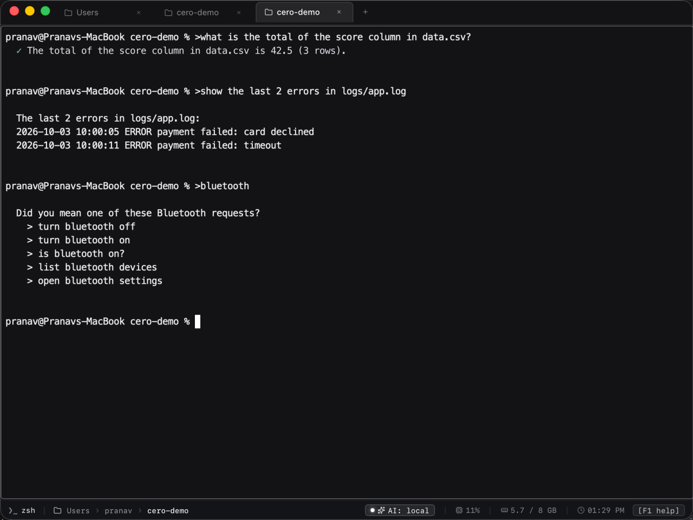
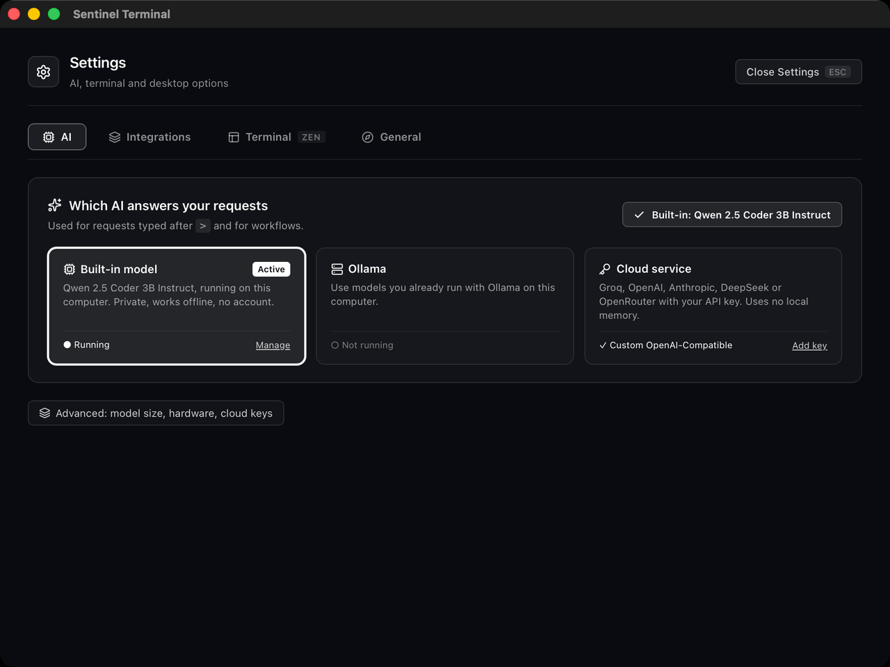

<div align="center">


# Cero for Windows

**A terminal that also takes requests in plain language, runs `.flow` setup files, and can use a model that runs on your own computer.**

[](https://github.com/NetPranav/Sentinal-Terminal/actions/workflows/ci.yml)
[](https://github.com/NetPranav/Sentinal-Terminal/releases)

[](LICENSE)

[Status](#status-of-the-windows-port) · [Why Cero](#why-cero) · [.flow files](#flow-files-write-a-setup-once-run-it-with-one-double-click) · [What you can ask](#what-you-can-ask) · [Open things by name](#open-folders-and-apps-by-name) · [Teaching](#teaching-cero) · [AI choices](#choose-your-ai) · [Download](#download) · [Build](#build-from-source) · [Docs](#documentation)



<sub>The logo animation as a video: [assets/brand/cero-logo-animation.mp4](assets/brand/cero-logo-animation.mp4)</sub>

</div>

Cero is a desktop terminal (Tauri v2, Rust, React 19, xterm.js). Commands you type run in a real
PowerShell session. Start a line with `>` and it becomes a request:

```text
PS C:\Users\me\demo> >what is the total of the score column in data.csv?
  ✓ The total of the score column in data.csv is 42.5 (3 rows).
```

Cero works out the commands, shows the ones that change anything for your approval, runs them in your
terminal and answers from their real output. Common requests run from tested code without a model call.
Everything else goes to the AI you choose (see [Choose your AI](#choose-your-ai)).

This branch (`windows`) builds Cero for Windows only. Users of Git Bash or WSL keep the protection of the
Unix command rules in the security engine.

## Status of the Windows port

The port is in progress. [ROADMAP.md](ROADMAP.md) has the plan (phases 0 to 10) and [COMPLETION.md](COMPLETION.md)
records what is done. In short:

- **Done:** the code base is Windows-only; the agent, chains, recipes and `.flow` files write PowerShell; the
  installers are `.msi` and setup `.exe`; CI runs on `windows-latest`.
- **Not done yet:** several system drivers (Wi-Fi, Bluetooth radio, brightness, volume, installed-app scan) answer
  "not available on Windows yet" until roadmap 3.7; the PTY, shell integration and security rules get their Windows
  work in phases 2 to 4; nothing has been run by hand on a Windows PC for this branch yet (phase 8).

## Why Cero

- **Plain language, real shell.** Ask for what you want; see the exact commands before anything that changes your
  files, system or network runs. Nothing is hidden from you.
- **`.flow` files.** One file, one double-click: Cero lists every command and runs nothing until you click Run.
- **It finds the real thing.** Say "open the folder gitBrains in VS Code" and Cero looks for the folder (spelling and case
  forgiven), asks when two match, and never creates a folder when you asked to open one.
- **Same answer every time.** The built-in model is run deterministically; requests that code can answer never reach it.
- **It learns only when you say so.** `/learn`, `/forget`. Nothing is learned by watching you.
- **You can stop it.** Ctrl+C stops a running request and its command; waiting requests sit in a queue you can see and edit.
- **Private by default.** The built-in model and Ollama keep requests on your computer. API keys live in the Windows
  Credential Manager.

## .flow files: write a setup once, run it with one double-click

A `.flow` file lists what to install, run and open. A tutorial, a teammate or you can write one. Double-click
it and Cero runs it with the right Windows commands.

```json
{
  "schemaVersion": "1.0",
  "metadata": { "id": "node-project", "name": "Node.js project" },
  "actions": [
    { "type": "install", "package": "nodejs" },
    { "type": "clone", "repo": "https://github.com/me/app.git", "into": "~/app" },
    { "type": "command", "command": "npm install", "cwd": "~/app" },
    { "type": "command", "command": "npm run dev", "windows": "npm.cmd run dev", "cwd": "~/app" },
    { "type": "browser", "url": "http://localhost:3000" }
  ]
}
```

| The flow contains | What happens |
|---|---|
| Only desktop actions: open Chrome, YouTube, VS Code, a folder | They open. **The terminal never appears**, and Cero quits afterwards if it was not already running. |
| Anything that installs or runs something | The terminal opens with one dialog listing every command. **Nothing runs until you click Run** (Enter does not approve a flow from a file). Each step is then typed into the terminal, so you see the output and can answer a prompt. The flow stops at the first failing step. |

`install` takes one package name, and Cero installs it with `winget` (`nodejs` becomes
`winget install -e --id OpenJS.NodeJS.LTS`). Values are quoted by Cero, so a flow cannot inject shell syntax
through a URL, name or path. Every run is written to the audit log. In a flow written on macOS or Linux, each step's
`windows` variant is used; a command without one runs as written in PowerShell.

### Make one by asking

You do not have to write the JSON. Tell the terminal the steps:

```text
>make me a workflow called dev setup that makes a folder called demo-project, goes into it,
 initializes git, creates a package.json with npm init -y, lists the files and opens notepad
```

Cero shows the steps in plain words, then asks where to keep the file: **1** Desktop, **2** this folder,
**3** `~\.cero\workflows` (listed in the Workflow Manager), or a path you type. It never replaces an existing
file, and a step it cannot understand is named and left out, never guessed.

### Save what you just did

Add the save words anywhere in a request. Cero runs the task first, then writes a `.flow` from the steps that really ran:

```text
>open spotify and save this as a workflow called my music on the desktop
>install node, save this as a workflow called node setup, then open vs code
>save the last 3 steps as a workflow called deploy
```

Every request to save ends with one plain line: `Saved workflow "name" (N steps) to <path>` or `Not saved: <reason>`.
Cero only ever writes `.flow` files (an old `.json` workflow is migrated, the original kept as `.json.bak`).

Format, actions and the package table: [docs/FLOW_FILES.md](docs/FLOW_FILES.md). Examples: [examples/flows](examples/flows).

## Open folders and apps by name

```text
>Please open a folder named gitBrains in VS Code. It is inside Projects
>open crome
>cd gitbrains
```

- The place you name is searched first (as written, then under your home folder), then the current folder, your usual project
  folders and your home folder.
- `gitBrains`, `git-brains` and `Git Brains` are the same name. A typo asks "Did you mean ...?". Two matches ask which one.
  A name that is not found is reported with where Cero looked, and **nothing is created or opened**.
- The editor gets the folder in one window (no second window). An app that is not installed is reported, never guessed.
- Your answers are remembered (`what do you remember about gitbrains`, `forget gitbrains`).
- A slipped first word is read as intended: `opne fldor docs in cod` becomes `open folder docs in code`.

## Stop it, queue it

- **Ctrl+C** stops the running request and the command it started; press it again to force the stop.
- Requests typed while one is running **wait in a queue**. `/queue` shows them; remove, move or clear them there.
- **Esc** closes Settings. Left and right arrows only move the cursor; the grey suggestion is accepted with Tab (or Right at the end of the line).

## What you can ask

Type `>` followed by the request. Examples:

| Request | What Cero does |
|---|---|
| `>what is the total of the score column in data.csv?` | Sums the column with a tested recipe and answers "42.5 (3 rows)" |
| `>show the last 2 errors in logs/app.log` | Prints the two lines (`Select-String`) |
| `>create a folder demo-app, go into it, run git init, then npm init -y, then list the files` | Plans all five steps, asks once, runs them, and leaves the shell in the new folder |
| `>open a new tab here and run python -m http.server 8765` | Asks once, opens the tab, starts the server there |
| `>what's running in my terminals` | Lists every terminal, its folder and its running command, without a model call |
| `>stop the server` | Confirms, then sends Ctrl+C to that tab |
| `>make me a workflow that installs node and opens youtube in edge` | Writes a `.flow` file from the steps and asks where to save it (see above) |
| `>close port 8765` | Finds what listens on exactly that port (`Get-NetTCPConnection`), names it, asks, stops that process and checks the port is free |
| `>run npm test in tab 2` | Types it there, or refuses and says why when that tab is busy or at a password prompt |
| `>why is npm test failing in api?` | Runs it there and explains the failure from the code it points to |
| `>fix buggy.py so it runs` | Runs the file, shows the change for approval (the original is kept as `.bak`), runs it again |
| `>open settings`, `>show my command history`, `>switch to zen mode`, `>go to tab 2` | The app's own functions |
| `>run the workflow in setup.flow` | Runs a flow from inside the terminal |

Commands that change files, the system or the network ask first and show exactly what will run. Reading
private keys or credential files always asks. Keys and tokens are masked before any output reaches a model.

## Teaching Cero

Cero never learns by watching you.

| You type | What happens |
|---|---|
| `/learn` | Teaches the request just above, if it worked with one command. |
| `/learn compress backups -> tar -czf backups.tgz ./backups` | Teaches a request and its command directly. |
| `/learned`, `/forget <id>` | See what was taught; remove one. |
| `/learning on` / `off` | Lets Cero keep a local record of its own failed requests. Off by default. |

A request that failed is never learnable. Details: [docs/LEARNING.md](docs/LEARNING.md).

## System settings by request

`>turn wifi off`, `>set brightness to 60`, `>mute`, `>turn on dark mode`, `>show paired bluetooth devices`,
`>open sound settings`. Each request becomes a Windows command, shown before it runs. Say only the topic
(`>bluetooth`) and Cero lists what it can do for it.

| Setting | Windows mechanism | State on this branch |
|---|---|---|
| Wi-Fi on/off, status, scan, join | Windows radio API, `netsh wlan` | Roadmap 3.7 |
| Bluetooth on/off, devices | Windows radio API, `Get-PnpDevice -Class Bluetooth` | Roadmap 3.7 |
| Brightness | WMI (built-in displays) | Roadmap 3.7 |
| Volume and mute | Core Audio | Roadmap 3.7 |
| Dark mode | Registry (apps and system) | Roadmap 3.7 |
| Battery, lock screen | `Win32_Battery`, `LockWorkStation` | Roadmap 3.7 |
| Open a settings page | `ms-settings:` | Roadmap 3.7 |

Changes ask first. When a switch is blocked (no radio, a policy, an external monitor without brightness
control), Cero says why and opens the matching settings page.

## Choose your AI

<div align="center">

</div>

One question: which AI answers your requests. Your choice is remembered across restarts, and the status bar shows what is
really answering (`AI: local`, `AI: Ollama`, `AI: API`).

| Choice | Notes |
|---|---|
| Built-in model | Runs on your computer through llama.cpp (Vulkan when `vulkan-1.dll` is present, else CPU). No account. |
| Ollama | Any model you already run. |
| Cloud key | OpenAI, Anthropic, Groq, DeepSeek, OpenRouter or any OpenAI-compatible endpoint. Keys are stored in the Windows Credential Manager, not in browser storage. |

Built-in model sizes (Settings, Advanced): **0.5B** (about 470 MB, for slow connections and old machines), **1.5B** (1.1 GB),
**3B** (2.1 GB, the default) and **4B** (2.5 GB). Interrupted downloads resume, and every file is checked against its SHA-256.

**How reliable is the built-in model?** Measured on a 3B model, 71 cases, the whole path (code routes, then the model, then the
safety check): the same prompt gave the same answer every time (flip rate 0.0%), and 85.9% of cases were right on the first
try. That was measured on the macOS build before the port; the Windows numbers come in roadmap 4.6. Method, numbers and the
known misses: [docs/MODEL_RELIABILITY.md](docs/MODEL_RELIABILITY.md).

## Download

Installers: the [Releases page](https://github.com/NetPranav/Sentinal-Terminal/releases), release `v<version>-windows`.

| Windows | File |
|---|---|
| Windows 10 (1803+) and 11, x64 | `Cero_<version>_x64_en-US.msi` or `Cero_<version>_x64-setup.exe` |

Each release has a `SHA256SUMS.txt`. The installers are not code-signed yet, so SmartScreen shows "Windows protected
your PC": choose "More info", then "Run anyway".

**Coming from Sentinel Terminal or Cero 2.2.0?** The app identifier is unchanged, so the installer is meant to upgrade
in place and keep your settings and the keys in the Credential Manager (checked in roadmap 6.3).

The optional `cero` command opens the app in a folder or runs a `.flow` file from any shell: see [assets/cli](assets/cli).

## Build from source

Requirements: Windows 10 or 11, Node.js 22, Rust (stable, MSVC toolchain), the Visual Studio Build Tools (C++ workload)
and WebView2 (part of Windows 11; see the [Tauri prerequisites](https://v2.tauri.app/start/prerequisites/)).

```powershell
npm install
npm run tauri dev          # run the app in development
npm run check:triple       # tests, production build and cargo check
npm run bundle:windows     # .msi and setup .exe (bundle:msi, bundle:nsis for one of them)
```

`scripts\windows\check-triple.ps1` runs the same three checks and stops at the first failure.

**On Linux** you can work on this branch too: `npm test` and `npm run build` run as usual, and `npm run check:rust` runs
`cargo xwin check --target x86_64-pc-windows-msvc` (install `cargo-xwin`, the `x86_64-pc-windows-msvc` target and LLVM;
see COMPLETION.md, 0.3).

Other scripts:
- `npm run cli`: the agent in a plain terminal, useful for trying requests without the window.
- `npm run smoke:engine`: checks that a llama.cpp server starts and accepts Cero's grammar.

## Documentation

| | |
|---|---|
| [ROADMAP.md](ROADMAP.md) · [COMPLETION.md](COMPLETION.md) | The Windows port plan and its progress |
| [docs/FLOW_FILES.md](docs/FLOW_FILES.md) | The `.flow` format and how it runs |
| [docs/LEARNING.md](docs/LEARNING.md) | Teaching Cero |
| [docs/MODEL_RELIABILITY.md](docs/MODEL_RELIABILITY.md) | How the built-in model is measured, and the results |
| [docs/releases](docs/releases) | Release notes |
| [docs/CODEBASE_MAP.md](docs/CODEBASE_MAP.md) | Where things live in the code |
| [SECURITY.md](SECURITY.md) · [CONTRIBUTING.md](CONTRIBUTING.md) | Reporting a problem; contributing |

## License

[MIT](LICENSE)
